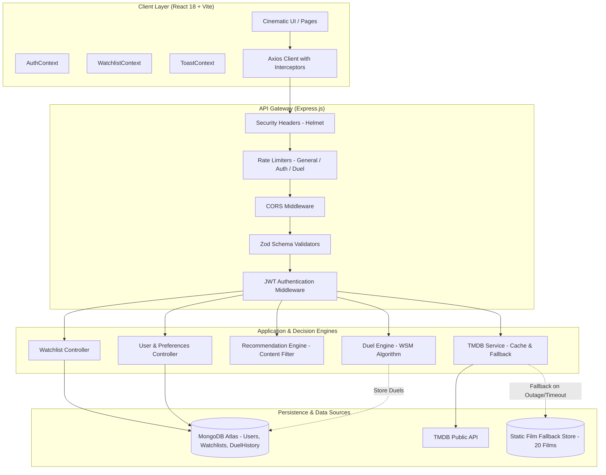

# Movie Duel — Architecture & Engineering Specification

## 1. System Architecture

---

## 2. Component Design & Responsibility Matrix

| Subsystem | Responsibilities | Key Technologies |
|---|---|---|
| **Client Core** | Single-page cinematic interface, client-side routing, optimistic UX state updates | React 18, React Router v6, Tailwind CSS v4 |
| **Animation & Micro-interactions** | Smooth transitions, duel score reveal counters, carousel snap scrolling | Framer Motion, CSS transforms |
| **API Proxy & Service** | Centralizes TMDB credentials server-side; enforces in-memory caching and retries | Node.js, Express, Axios, NodeCache |
| **Decision Engine (WSM)** | Normalizes criteria, rebalances weights, computes score differential, synthesizes explanations | Deterministic Multi-Criteria Decision Analysis (WSM) |
| **Recommendation Engine** | Heuristic candidate ranking matching saved user preferences and watchlist seeds | Content-based filtering, Jaccard similarity |
| **Persistence Layer** | Stores credentials with salted bcrypt hashes, watchlists with compound uniqueness, user preferences | MongoDB Atlas, Mongoose 8 |

---

## 3. Duel Decision Engine: Mathematical Formulation

### 3.1 Normalization Transformations

Each input attribute $x$ for a candidate film $m$ is converted to a standardized sub-score $s_i(m) \in [0, 100]$.

#### Rating Criterion ($s_{\text{rating}}$)
Maps raw rating $R \in [0, 10]$ to a percentage scale, attenuated by vote confidence $V$:
$$s_{\text{rating}}(m) = \left(\frac{R}{10} \times 100\right) \times \min\left(1, \frac{V}{50}\right)$$

#### Genre Similarity ($s_{\text{genre}}$)
Computes the Jaccard similarity coefficient between the movie's genre set $G_m$ and the user's preferred genre set $G_u$:
$$s_{\text{genre}}(m) = \begin{cases} 
50 & \text{if } G_u = \emptyset \\
\frac{|G_m \cap G_u|}{|G_m \cup G_u|} \times 100 & \text{otherwise}
\end{cases}$$

#### Runtime Match ($s_{\text{runtime}}$)
Evaluates duration $T$ against the user's preferred bounds $[T_{\min}, T_{\max}]$:
$$s_{\text{runtime}}(m) = \begin{cases}
50 & \text{if no preference} \\
100 & \text{if } T_{\min} \le T \le T_{\max} \\
\max\left(0, 100 - \frac{|T - \text{bound}|}{30} \times 25\right) & \text{if outside bounds}
\end{cases}$$

#### Popularity Metric ($s_{\text{popularity}}$)
Applies a logarithmic compressor to dampen blockbuster outliers:
$$s_{\text{popularity}}(m) = \min\left(100, \frac{\log_{10}(P + 1)}{\log_{10}(1000)} \times 100\right)$$

---

## 4. Resilience & Fallback Architecture

To satisfy strict production uptime guarantees:

1. **3-Tier Fallback Hierarchy:**
   - **Tier 1 (In-Memory Cache):** Rapid responses for trending (10 min TTL), details (1 hour TTL), and genres (24 hours TTL).
   - **Tier 2 (External TMDB API with Retries):** 3 attempts with exponential backoff (1s, 2s, 4s delays) and 10-second timeout.
   - **Tier 3 (Static Offline Dataset):** 20 critically acclaimed films (Inception, The Dark Knight, Interstellar, Pulp Fiction, etc.) pre-packaged with poster paths, overviews, ratings, and runtime metadata, guaranteeing zero 500 errors if TMDB is offline or without keys.

2. **Database Fallback:**
   - If MongoDB Atlas is connecting or unreachable, read-only discovery, search, and duel endpoints continue functioning seamlessly.
